# AgentUI

**A local web app for building a team of AI agents and orchestrating them.** Give each agent a role, a model and tools. Then connect them on a visual canvas, or hand a big task to a lead agent that splits it up and delegates the parts. You can watch every step live.

It works with your **Claude, ChatGPT and Gemini subscriptions** (no API key needed), **free local models via Ollama**, and **any API-key provider**. You can mix all of these in a single workflow.

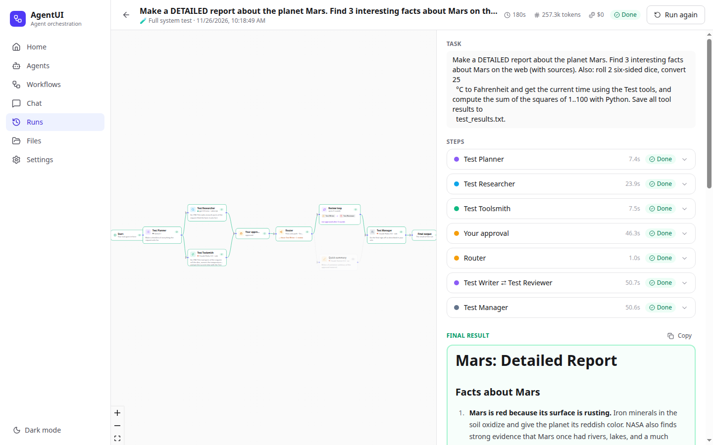

---

## Contents

- [Highlights](#highlights)
- [Quick start](#quick-start)
- [Connecting models](#connecting-models)
- [Core concepts](#core-concepts)
- [Autonomy and safety](#autonomy-and-safety)
- [Tool servers (MCP)](#tool-servers-mcp)
- [The website team](#the-website-team)
- [Testing the whole system](#testing-the-whole-system)
- [How it works](#how-it-works)
- [Project layout](#project-layout)
- [Security model](#security-model)
- [Troubleshooting](#troubleshooting)
- [License](#license)

---

## Highlights

| | |
|---|---|
| 🧑‍🤝‍🧑 **Agents** | Each agent has a role, a model, tools, a creativity setting and a step limit. Lead agents can hand work to a chosen **team**, including **several tasks at once that run in parallel**. |
| 🔀 **Visual workflows** | Drag agents onto a canvas and connect them. Steps fed by the same step run **in parallel**, and a step with several inputs **waits for all of them**. A **Router** sends work down one branch, a **Review loop** repeats until a reviewer approves, and **Your approval** pauses the run for you. |
| 🔑 **Subscriptions, local or API** | Claude Pro/Max (via Claude Code), ChatGPT Plus/Pro (via Codex CLI), Gemini (via Gemini CLI), Ollama, Anthropic, OpenAI, Gemini API, OpenRouter, and any OpenAI-compatible server. |
| 📺 **Live runs** | Text streams in as it's written. You see every tool call, every hand-off between agents, review rounds, approvals, tokens and cost, and the canvas lights up as steps run. You can stop a run at any time. |
| 🛠️ **Tools** | Web search, reading web pages, HTTP APIs, files (read, write, edit, with syntax checks on save), a website QA checker, and Python and shell code in a **Docker sandbox**. |
| 🔌 **MCP tool servers** | Connect GitHub, Slack, email, databases, browsers and thousands more. Search the **official MCP registry** from the app. Servers that need an account get a **one-click login (OAuth)**. |
| 🛡️ **Safety** | Every tool has a rule: **Allow / AI check / Ask me / Block**. Approval steps have three modes. There's an **Autonomous** switch, a cost limit, timeouts, and sandboxed website previews. |
| 🌐 **Website preview** | Agents build sites in the shared workspace, and you preview them on desktop, tablet and phone sizes, safely sandboxed. |

<table>
<tr>
<td>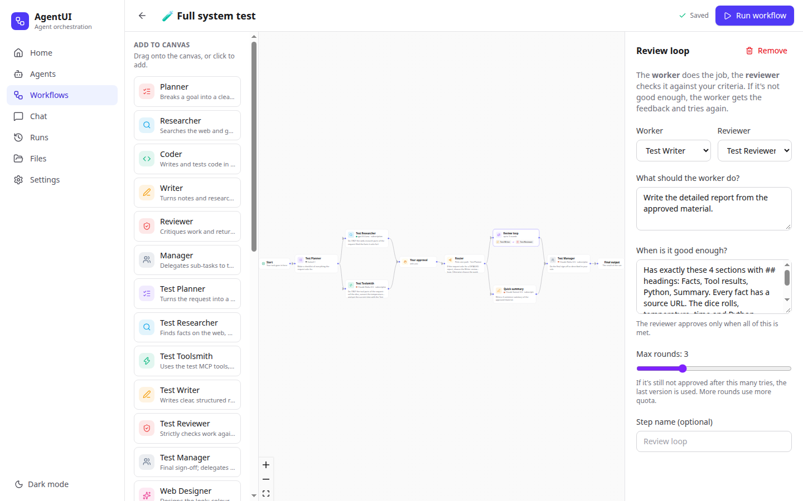<br><sub><b>Workflow editor:</b> drag agents, connect them, configure each step</sub></td>
<td>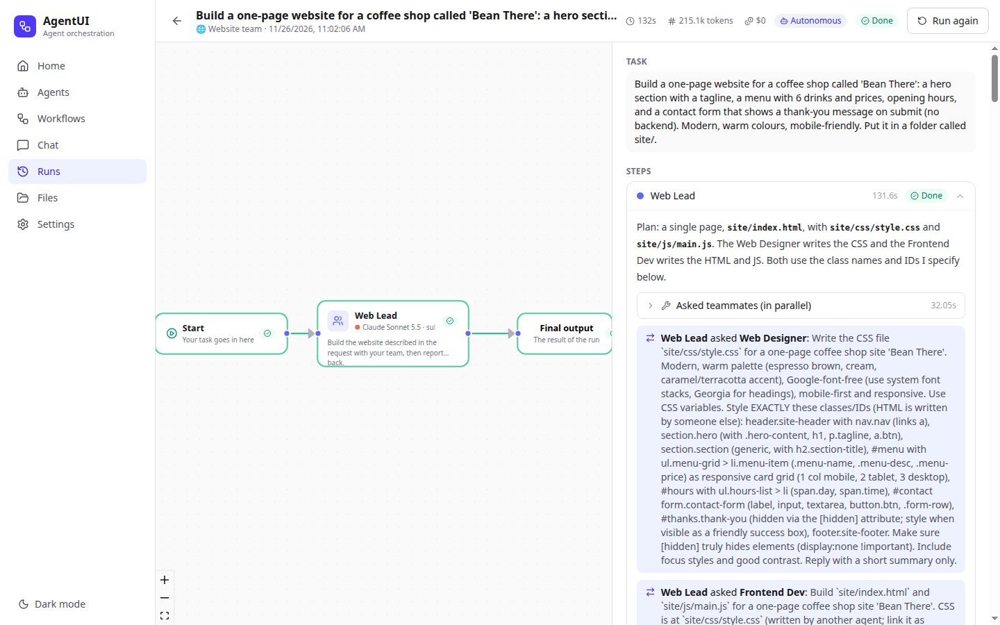<br><sub><b>A lead agent delegating</b> to the Designer and Frontend Dev in parallel</sub></td>
</tr>
<tr>
<td>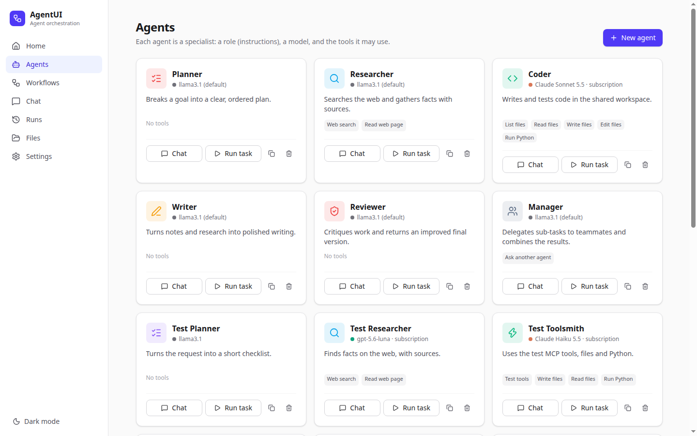<br><sub><b>Agents:</b> roles, models and tools at a glance</sub></td>
<td>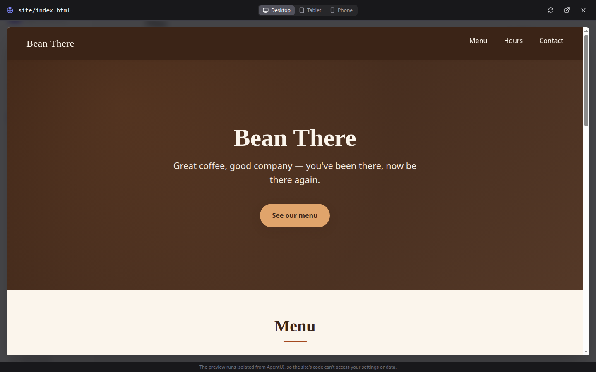<br><sub><b>Website preview</b> of a site the agents built in about 2 minutes</sub></td>
</tr>
<tr>
<td>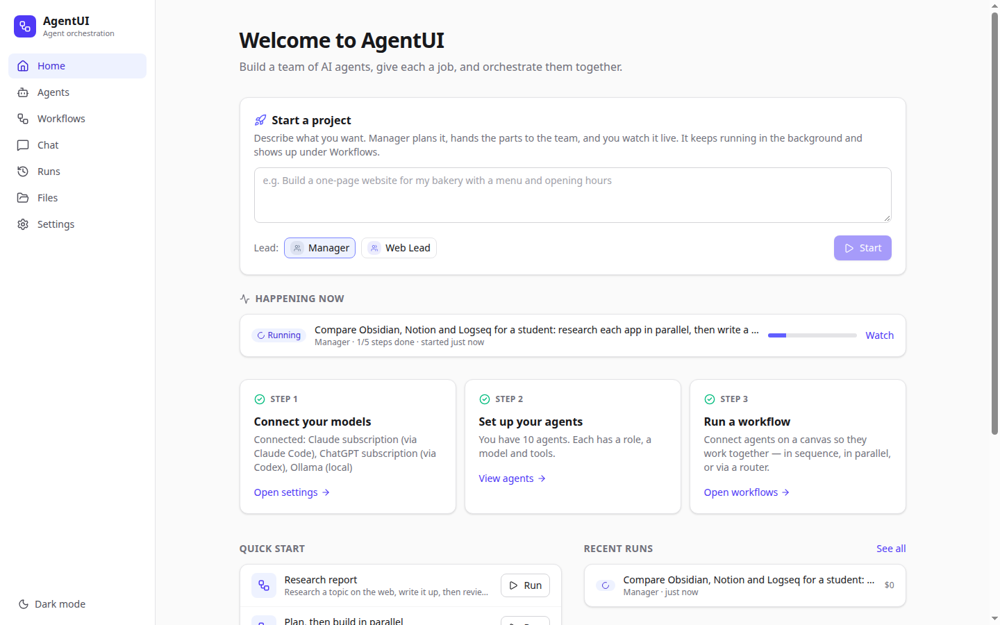<br><sub><b>Home:</b> getting started, quick runs, recent runs</sub></td>
<td>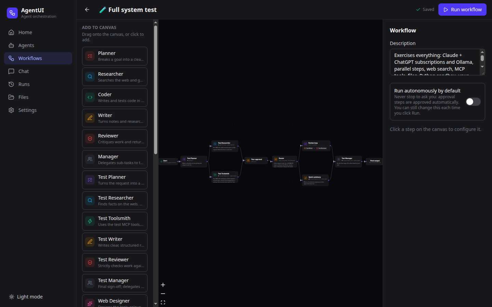<br><sub><b>Dark mode</b></sub></td>
</tr>
</table>

---

## Quick start

**Requirements:** Python 3.10+, Node.js 18+. *Optional:* Docker (for code execution), Ollama (local models), and the Claude Code / Codex / Gemini CLIs (to use your subscriptions).

```bash
git clone https://github.com/Jurgenw81/AgentUI.git
cd AgentUI
./start.sh                 # → http://localhost:3000
```

The first launch creates a Python virtual environment, installs the npm packages and builds the UI. After that it starts in a couple of seconds. Use `PORT=4000 ./start.sh` to choose another port.

Then:

1. **Settings:** connect at least one model source (see below).
2. **Agents:** pick a model for each agent, or set one **default model** for all of them.
3. **Workflows:** open a template and click **Run**. You can also chat with a single agent under **Chat**.

### Development mode

```bash
./dev.sh   # backend with auto-reload on :8000, UI with hot reload on :3000
```

---

## Connecting models

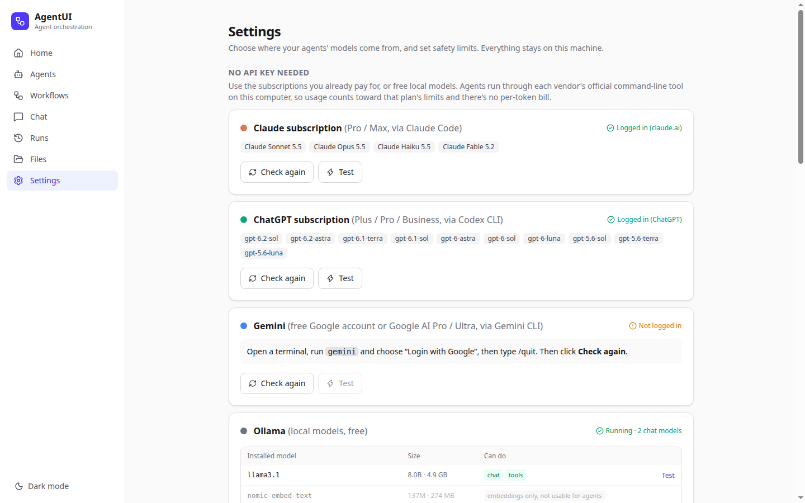

### No API key needed

| Source | What you need | How it's used |
|---|---|---|
| **Claude Pro / Max** | [Claude Code](https://claude.com/claude-code) installed. Run `claude` once and log in with your subscription. | Agents run through `claude -p` (headless). |
| **ChatGPT Plus / Pro / Business** | `npm install -g @openai/codex`, then `codex login` → *Sign in with ChatGPT*. | Agents run through `codex exec`, in a read-only sandbox. |
| **Gemini** (free Google account or Google AI Pro/Ultra) | `npm install -g @google/gemini-cli`, then `gemini` → *Login with Google*. | Agents run through `gemini -p`. *(Newest integration, and less tested than the other two.)* |
| **Ollama** (free, local) | [Ollama](https://ollama.com) running, plus a model, e.g. `ollama pull qwen2.5-coder:14b`. | Settings lists every installed model, with its size and whether it supports tools. |

Subscription agents **keep AgentUI's tools**. AgentUI gives them to the CLI through a small built-in MCP bridge, so web search, files, the code sandbox, delegation and MCP servers all work, and every call shows up in the live timeline. Your personal CLI settings and the CLIs' own built-in tools are not used. Usage counts toward your plan's limits, so runs show tokens with a cost of $0.

### API keys (optional)

Anthropic, OpenAI, Google Gemini, OpenRouter, or any **OpenAI-compatible** server (LM Studio, vLLM, Groq…). Paste a key in Settings, or set `ANTHROPIC_API_KEY`, `OPENAI_API_KEY`, `GEMINI_API_KEY` or `OPENROUTER_API_KEY`. Model lists are fetched live from each provider.

> **Tip:** small local models are fine for planning, routing and summarizing, but weak at multi-step coding. Give coding and "lead" agents a strong model. Each agent can use a different model.

---

## Core concepts

### Agents

An agent has a **role** (system prompt), a **model**, **tools**, a **creativity** setting (temperature) and a **max tool steps** limit. Agents with *Ask another agent* can delegate, either to everyone or to a chosen **Team**. They can also hand out several independent tasks at once with `delegate_parallel`, and those run at the same time.

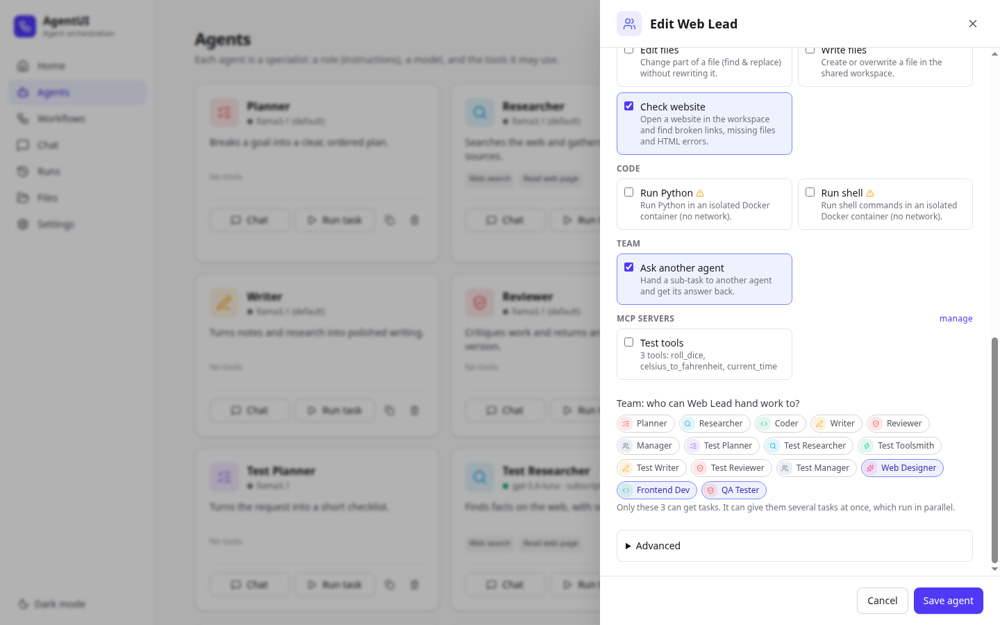

### Workflows

| Step | What it does |
|---|---|
| **Start** | Where the task you type enters the workflow. |
| **Agent** | Runs an agent. It receives the step's instructions, the original task and the output of every step connected into it. |
| **Router** | An AI reads the task and picks **one** outgoing branch. The other branches are skipped. |
| **Review loop** | A **worker** produces something and a **reviewer** checks it against your criteria. If it fails, the worker gets the feedback and tries again, up to *N* rounds. |
| **Your approval** | A checkpoint, with the modes *Ask me*, *AI checks (asks me only if needed)* or *Auto-approve*, plus an optional timeout. |
| **Output** | Collects the final result. |

Rules: a step that feeds several steps runs them **in parallel**, and a step with several inputs **waits for all** of them. Loops in the graph aren't allowed; use a Review loop step instead.

### Runs and chat

Every workflow run is saved, with a live canvas, a timeline for each step, the final result, tokens and cost. You can stop or re-run any of them. **Chat** lets you talk to a single agent, which is handy for testing an agent before putting it in a workflow.

---

## Autonomy and safety

AgentUI is built for agents that **finish a task on their own**, but you decide where a human, or an AI checker, stays involved.

- **Autonomous switch:** set it per run (in the Run dialog), per workflow, or as a global default. An autonomous run **never waits for you**: approval steps are approved automatically, and AI-checked steps pass any concerns on to the next agents.
- **Approval steps:** *Ask me*, *AI checks, asks me only if needed*, or *Auto-approve*, plus "approve/reject if I don't answer within N minutes".
- **Tool safety rules:** every tool is *Allow*, *AI check*, *Ask me* or *Block*. MCP tools that **send, post, create, delete or pay** default to *Ask me*. Declining a call doesn't stop the run: the agent is told why and carries on without that action. In autonomous runs, an AI safety check decides instead of you.
- **Cost limit per run:** default $2, for API-key models.
- **Code sandbox:** off by default. Code runs in a throwaway `python:3.12-slim` container with **no network**, 512 MB RAM, 1 CPU and a 60 s timeout. Only the workspace folder is shared.

<table>
<tr>
<td>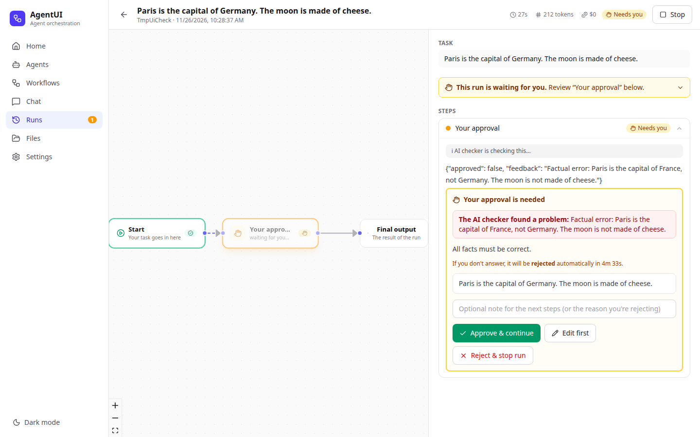<br><sub>An <b>AI check</b> caught wrong facts and asked a human, with a countdown before the timeout decides</sub></td>
<td>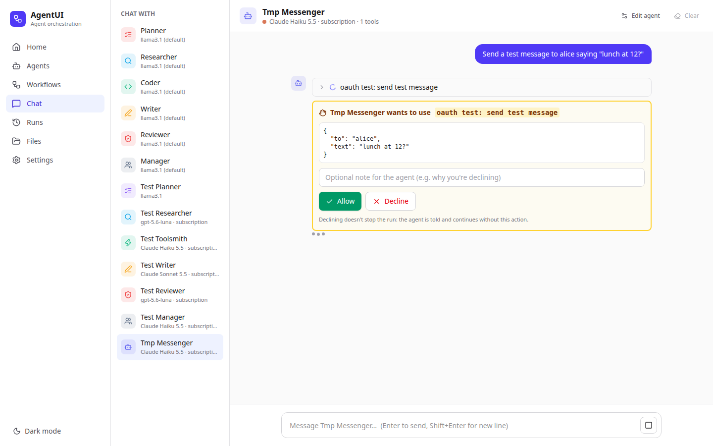<br><sub>A <b>risky tool call</b> (sending a message) waiting for <i>Allow / Decline</i></sub></td>
</tr>
</table>

---

## Tool servers (MCP)

Agents can use any [Model Context Protocol](https://modelcontextprotocol.io) server, which covers thousands of services.

- **Browse catalog:** search the **official MCP registry** inside Settings. *Add* fills in the command or URL and lists the keys it needs.
- **Hubs:** Zapier, Composio or Pipedream connect hundreds to thousands of apps (Gmail, Slack, Sheets, Notion…) through one server.
- **Local command** (`npx …`, `uvx …`, `docker run …`) or **Remote URL** (streamable HTTP).
- **Log in:** remote servers that need an account get a **Log in** button. AgentUI uses OAuth with dynamic client registration and PKCE. Tokens are stored locally and refreshed automatically.
- **Per-tool safety rules**, set under each server's *Tools & safety rules*.

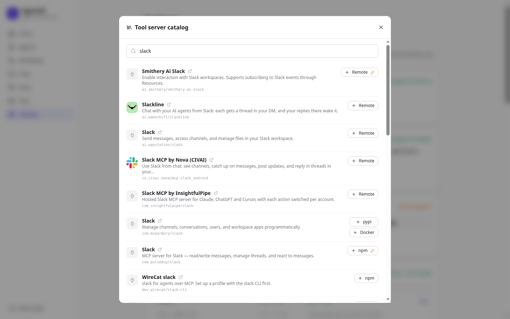

> Anyone can publish to the registry, and entries aren't reviewed. Prefer servers published by the service's own company, and check the source link.

---

## The website team

The **🌐 Website team** workflow uses a **Web Lead** that plans the site and delegates the work, in parallel where it can, to a **Web Designer**, a **Frontend Dev** and a **QA Tester**. The QA Tester has a **Check website** tool that follows the site's links and reports broken links, missing CSS/JS/images, unclosed tags, broken brackets and basic accessibility problems. The Lead sends work back for fixes until QA passes.

Example task: *"A one-page website for a coffee shop called 'Bean There': hero, menu with 6 drinks and prices, opening hours, and a contact form that shows a thank-you message."* In testing, this finished in about 2 minutes. Preview the result under **Files → Websites → Preview**.

---

## Testing the whole system

`backend/examples/create_test_workflow.py` builds **🧪 Full system test**, a single workflow that exercises everything:

- Claude + ChatGPT subscriptions and Ollama
- parallel steps
- web search, MCP tools, files and the Python sandbox
- your approval, a router, a review loop, and delegation

```bash
backend/.venv/bin/python backend/examples/create_test_workflow.py   # with AgentUI running
```

It prints the exact task to paste when you click **Run**.

Two small test servers are also included:
- `test_mcp_server.py`: dice, temperature conversion, a clock
- `test_oauth_mcp_server.py`: an MCP server that requires an OAuth login, with a pretend *Allow* page, for trying the login flow

---

## How it works

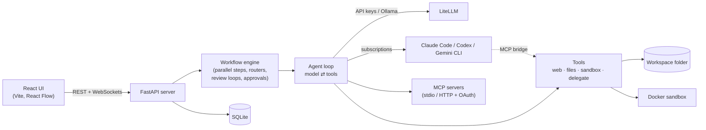

- **The engine** runs the workflow graph. A step starts when all of its inputs are finished or skipped. Routers mark the branches they didn't choose as skipped, review loops and approvals run inside their own step, and errors stop the run.
- **The agent loop** streams model output, runs tool calls (concurrently when there are several), applies the tool safety rules, and repeats until the model gives a final answer or reaches its step limit.
- **Subscription models** run the vendor's CLI headless. The agent's tools are offered to the CLI through `mcp_bridge.py`, which calls back into the engine, so policies, approvals and the live timeline all still apply.
- **Live events** are stored in SQLite and streamed to the UI over WebSockets. A run you open midway shows its full history so far.

---

## Project layout

```
backend/app/
  main.py          REST + WebSocket API, serves the built UI and sandboxed previews
  engine.py        agent loop, workflow orchestrator, approvals, live event hub
  llm.py           multi-provider model layer (LiteLLM), model discovery, Ollama capabilities
  cli_agent.py     agents via Claude Code / Codex / Gemini CLI (subscriptions)
  mcp_bridge.py    tiny MCP server handing AgentUI's tools to those CLIs
  mcp_manager.py   connections to external MCP servers (+ OAuth login)
  policies.py      per-tool safety rules (allow / ai / ask / block)
  tools.py         built-in tools + Docker sandbox + website checker
  db.py            SQLite storage (backend/data/)
  seed.py          starter agents and workflows
backend/examples/  full-system-test builder and test MCP servers
frontend/src/
  pages/           Home, Agents, Workflows, WorkflowEditor, RunView, Chat, Runs, Files, Settings
  components/      canvas nodes, activity timeline, model picker, MCP settings, UI kit
docs/screenshots/  images used in this README
```

All data (agents, workflows, runs, settings, API keys, OAuth tokens) lives in `backend/data/` on your machine. To reset everything, stop the server and delete that folder.

---

## Security model

AgentUI is a **single-user app for your own computer**:

- The server listens on `127.0.0.1` only, and has **no login**, so don't expose it to a network.
- Requests that change things, and WebSocket connections, are only accepted from AgentUI's own pages. Other websites you have open can't use the API.
- Website previews are served with a CSP `sandbox` header. Agent-written JavaScript runs on its own isolated origin, even when opened in a new tab, and can't read or change anything in AgentUI.
- File tools can't leave the workspace folder. Code runs only in the Docker sandbox, which has no network access.
- Local MCP servers run with **your** user's permissions, so only add ones you trust.
- API keys and OAuth tokens are stored unencrypted in the local SQLite database.

---

## Troubleshooting

| Problem | What to check |
|---|---|
| *"Code execution is disabled"* | Settings → Code execution → switch it on (needs Docker). |
| A subscription shows **Not logged in** | Run `claude`, `codex login` or `gemini` in a terminal and log in, then click **Check again**. |
| Ollama is **Not reachable** | Start Ollama (`ollama serve`) and check the address in Settings. |
| A local model writes broken files | AgentUI syntax-checks files on save and tells the agent to fix them. Still, use a stronger or coding model (e.g. `qwen2.5-coder`) for coding agents. |
| Web search returns nothing | The free search engines sometimes block automated queries. AgentUI tries several in turn; try again later or rephrase. |
| An MCP server **can't connect** | Check that its command is installed (`npx`, `uvx`, `docker`), that required environment variables or headers are filled in, or click **Log in** if shown. |
| *"Port 3000 is already in use"* | AgentUI is probably already running. Open it, or run `PORT=4000 ./start.sh`. |

---

## License

[MIT](LICENSE): free to use, copy, modify and distribute, including commercially. Keep the copyright notice.
